# AI Supported Software Development Process

Specialized AI agents in every phase of a SCRUM sprint, each with one narrow task and a clear input and output. The agents do routine checking and drafting. People keep the decisions.



<sub>The animation walks through one sprint: the highlighted phase is active, the green dot follows the data from input through the agent to the output. The [original diagram](image.png) is kept for reference.</sub>

This repository holds the concept and the matching [Claude skills](skills/), one per agent. Related LinkedIn article: [Agents in Agile Software Development Process](https://www.linkedin.com/pulse/agents-agile-software-development-process-andre-rochlitz-sud0e/).

## Contents

1. [The idea](#the-idea)
2. [The process at a glance](#the-process-at-a-glance)
3. [The agents phase by phase](#the-agents-phase-by-phase)
4. [Skills in this repository](#skills-in-this-repository)
5. [Installing and using the skills](#installing-and-using-the-skills)
6. [Further agents](#further-agents)
   - [Integration into Jira, Confluence and Git](docs/integration-jira-confluence-git.md)
7. [Guardrails](#guardrails)
8. [Benefits and limits](#benefits-and-limits)
9. [Introducing it step by step](#introducing-it-step-by-step)

## The idea

SCRUM already splits work into small steps with defined inputs and outputs: a story goes in, a refined story comes out; a sprint proposal goes in, a verified plan comes out. That structure fits agents well. Instead of one large assistant that "helps with everything", each step gets its own agent.

The design follows the same rules as good microservices:

- **One responsibility per agent.** An agent that reviews stories does not plan sprints.
- **Explicit contract.** The input and the output of every agent are written down.
- **Results land where the team already works.** Comments on the story, a message in the team chat, a TODO in the code, a file next to the source.
- **The team can ignore or overrule every result.** The agent proposes; it does not decide.

## The process at a glance

| Phase | Input | Agent | Output |
| --- | --- | --- | --- |
| Backlog Refinement | User story, acceptance criteria, Definition of Ready | Backlog Agent | Reworked story with comments on estimation, feasibility and better wording |
| Planning 1 | User stories, backlog, time-off calendar | Planning Agent | Planning verification: dependencies, capacity, warnings to the team chat |
| Planning 2 | User story, project code | Specification Agent | Structured specification as comments and a file in the repository |
| Testing | User story, code repository | Testing Agent | Generated test cases |
| Code Review | Definition of Done, acceptance criteria, git branch | Review Agent | TODO comments committed to a review branch |

## The agents phase by phase

### 1. Backlog Refinement: Backlog Agent

A story is only as good as its acceptance criteria. The Backlog Agent reads each new or changed story and checks it against the Definition of Ready. It looks at structure (role, goal, benefit), testability of each criterion, size and feasibility in the existing code base.

The result is a reworked story and a list of comments, for example "criterion 2 says *fast*: which response time?". Open questions go back to the product owner. The agent never deletes a criterion; it marks changes and gives the reason.

### 2. Planning 1: Planning Agent

During sprint planning the Planning Agent checks the proposal against what the team cannot easily keep in mind: dependencies between stories (including hidden ones through shared code or database migrations), developer capacity, and absences from the time-off calendar.

It reports available person-days against planned effort with the calculation shown, lists dependencies with their status, and suggests an order that unblocks others first. Warnings go to the team chat as a short "planning verification" message. Missing data, such as an empty calendar, is reported as a finding instead of guessed.

### 3. Planning 2: Specification Agent

Before implementation starts, the Specification Agent turns the story and the repository into a short specification that is committed with the code. It lists goal, testable behaviour, interfaces, out-of-scope items, risks and test notes. Short `SPEC` comments in the code point back to the statements.

This gives people and coding agents the same source of truth and makes later review easier: every statement maps to an acceptance criterion.

### 4. Testing: Testing Agent

The Testing Agent derives test cases from the story and the specification, not from the finished code, so the tests check the requirement and not the implementation. It writes positive tests per acceptance criterion and adds negative and edge cases such as empty input, limits, missing permissions and concurrent access.

It follows the project's test framework and naming, runs the tests, and reports acceptance criteria that cannot be tested automatically.

### 5. Code Review: Review Agent

The Review Agent compares the changes of a branch with the Definition of Done and the acceptance criteria. For each criterion it looks for the code and the test that cover it. Findings carry a severity (`blocker`, `should fix`, `nit`), a file and line, and a reason.

Findings are written as `TODO(review)` comments on a separate review branch. The original branch stays untouched, so the author decides what to take over.

## Skills in this repository

Each agent is described as a Claude skill: a `SKILL.md` with a short description that tells the model when to use it, followed by input, steps, output and rules.

| Skill | Phase | Purpose |
| --- | --- | --- |
| [`backlog-refinement`](skills/backlog-refinement/SKILL.md) | Backlog Refinement | Review a story against the Definition of Ready |
| [`sprint-planning`](skills/sprint-planning/SKILL.md) | Planning 1 | Verify dependencies, capacity and absences |
| [`specification`](skills/specification/SKILL.md) | Planning 2 | Write a specification next to the code |
| [`test-case-generation`](skills/test-case-generation/SKILL.md) | Testing | Generate runnable tests from the story |
| [`code-review-dod`](skills/code-review-dod/SKILL.md) | Code Review | Review a branch against the Definition of Done |
| [`security-review`](skills/security-review/SKILL.md) | Code Review / CI | Security findings on the diff |
| [`architecture-review`](skills/architecture-review/SKILL.md) | Code Review | Check fit with architecture and ADRs, draft new ADRs |

## Installing and using the skills

Copy the skills into a project or into your user folder:

```bash
# for one project
mkdir -p .claude/skills && cp -r skills/* .claude/skills/

# for all projects of your user
mkdir -p ~/.claude/skills && cp -r skills/* ~/.claude/skills/
```

Then start Claude Code and ask for the step, or call the skill by name:

```text
Refine user story PROJ-142 with the backlog-refinement skill. DoR is in docs/dor.md.
Check the sprint proposal in sprint-14.md with sprint-planning. Calendar: team-calendar.ics.
Write a specification for PROJ-142 (specification skill).
Generate tests for PROJ-142 from the spec (test-case-generation).
Review branch feature/PROJ-142 against docs/dod.md (code-review-dod).
```

The skills assume that the story, the Definition of Ready and the Definition of Done are available as text, for example in the repository or exported from the ticket system. How your tracker is connected (MCP server, export, copy and paste) is up to your setup.

## Integration into Jira, Confluence and Git

The agents work inside the tools a team already uses. Jira holds stories and sprints, Confluence holds the Definition of Ready and Done, the architecture and generated pages, and Git holds code, specs and review branches. Webhooks and CI events start the skills, and the results come back as comments, pages and branches. The full description with triggers, rules, a pipeline sketch and security notes is in [docs/integration-jira-confluence-git.md](docs/integration-jira-confluence-git.md).

## Further agents

The diagram lists more agents that fit the same pattern:

- **Coding agents:** Security Agent, Unit Testing Agent, Architect Agent. They run while code is written. The `security-review` and `architecture-review` skills cover two of them.
- **CI agents:** E2E Test Agent, Security Agent, Deployment Agent. They run in the pipeline and report to the build.
- **SCRUM agents:** Review Agents, Planning Agents, Test Case Agents and Presentation Agents. The last one prepares the sprint review: what was done, what was not, and why.

## Guardrails

- **Human in the loop.** Agents comment, propose and warn. Merge, scope and priority stay with the team.
- **Least privilege.** Review agents read code and write to a review branch. Nobody gives them access to production or secrets.
- **Traceability.** Every agent result is stored as a comment, file or commit and linked to the story. Nothing happens only in a chat window.
- **No silent rewrites.** Changes to stories and code are visible as suggestions with a reason.
- **Honest gaps.** If data is missing, the agent says so instead of making up numbers.
- **Keep the Definition of Ready and Done short and current.** Agents are only as good as these texts.

## Benefits and limits

**Benefits**

1. **Productivity.** Routine checks are automated. The team spends time on design and decisions.
2. **Consistency.** The same checks run on every story and every branch.
3. **Faster feedback.** Problems with a story show up at refinement, not in the review.
4. **Traceability.** Findings link to stories and commits.
5. **Improvement over time.** Rejected findings show where the rules or the skills need to be sharpened.

**Limits**

- Agents can be wrong or too confident. Every result needs a quick human check, and the check gets cheaper only when the agent explains its reasoning.
- Generated tests can encode a misunderstanding of the requirement. Deriving them from the story, and having people read them, reduces this risk but does not remove it.
- An agent cannot judge business value or politics inside the team.
- Quality depends on the input: vague stories give vague findings.

## Introducing it step by step

1. Start with **Backlog Refinement**. The risk is low and the benefit is visible within one sprint.
2. Add the **Review Agent** on a review branch, and compare its findings with human reviews for a few sprints.
3. Add **Planning** checks once capacity and calendar data are reliable.
4. Add **Specification** and **Testing** when stories are clear enough to derive tests from.
5. Move security and architecture checks into the pipeline last.

After each step, look at which findings the team accepted and which it rejected, and adjust the skills.
