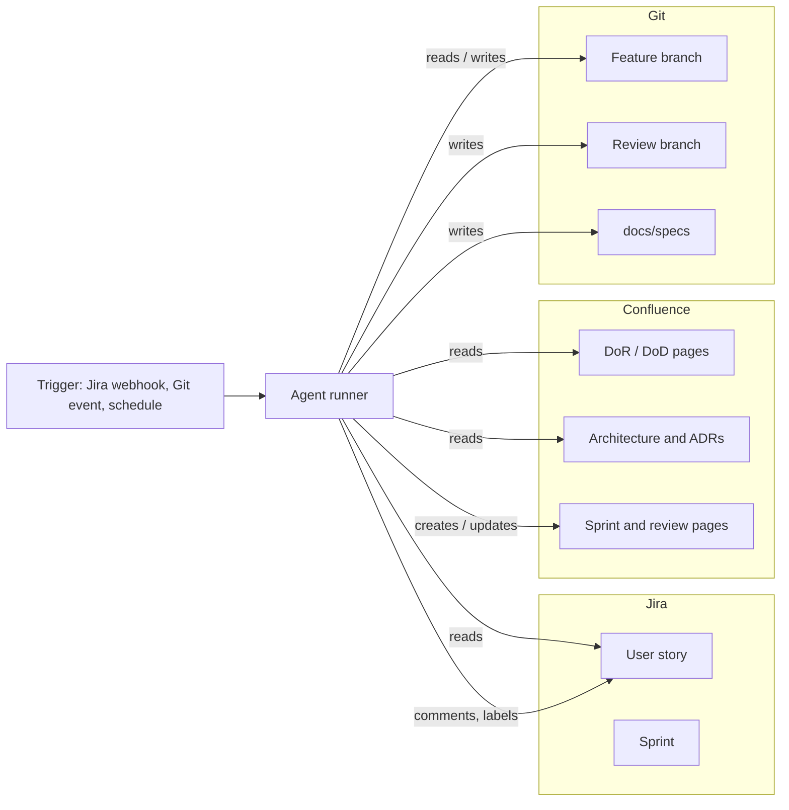

# Integration into Jira, Confluence and Git

How the agents from this repository fit into the tools a team already uses. The tools keep their role: **Jira** holds the work, **Confluence** holds the rules and the documentation, **Git** holds the code. The agents read from all three and write their results back as comments, pages and branches. Nothing happens in a place nobody looks.

## Overview



The **agent runner** is a small service or a CI job. It receives an event, starts the matching skill from [`skills/`](../skills/) with the right context, and posts the result. It holds the credentials, not the agents' prompts.

## Roles of the tools

| Tool | Source of truth for | Agents read | Agents write |
| --- | --- | --- | --- |
| Jira | Stories, acceptance criteria, sprint scope, estimates | Story, linked stories, sprint, assignee, capacity fields | Comments, labels, a checklist result, links to pages and branches |
| Confluence | Definition of Ready and Done, architecture, ADRs, team calendar page | DoR, DoD, ADRs, working agreements | Sprint planning page, review summary, draft ADRs (as drafts) |
| Git | Code, tests, specs | Diff, tests, repository layout | Spec files, tests, review branch with TODO comments, PR status |

## Jira

### Triggers

| Event | Skill | Result in Jira |
| --- | --- | --- |
| Story created or acceptance criteria changed (webhook `issue_updated`) | `backlog-refinement` | Comment with verdict, reworked text and open questions; label `agent-reviewed`; optional label `needs-rework` |
| Story moved to a "Refined" status | `backlog-refinement` (final check) | Comment only if the story no longer meets the DoR |
| Sprint is created or scope changes (webhook `sprint_updated`) | `sprint-planning` | Comment on the sprint or a linked planning page, warning message to the team chat |
| Story moved to "In Progress" | `specification` | Link to the new spec file in the story |
| Story moved to "In Review" | `code-review-dod`, `security-review`, `architecture-review` | Summary comment with counts per severity and a link to the review branch |

### Rules for the Jira side

- Agent comments start with a fixed prefix, for example `[Backlog Agent]`, so people can filter them.
- The agent proposes text in the comment. It does **not** edit the description or the acceptance criteria. The product owner copies what they accept.
- Labels are the only structured marker: `agent-reviewed`, `needs-rework`, `spec-ready`. They allow dashboards and JQL, for example `labels = needs-rework AND sprint in openSprints()`.
- Use a dedicated service account, so comments are clearly from an agent, and so rights can be limited (browse, comment, edit labels; no transitions, no deletion).
- Prevent loops: ignore events caused by the service account itself.

### Connecting

Two common ways:

1. **Webhooks plus the REST API.** Jira sends the event to the runner. The runner reads the issue through the REST API and posts the comment.
2. **An MCP server.** Atlassian offers a remote MCP server for Jira and Confluence, and community servers exist. With one, a skill can read and write directly. Check the current Atlassian documentation for the authentication flow and supported tools before relying on it.

## Confluence

### What lives there

Put the rules where the team can read and change them, and let the agents use them as input.

| Page | Used by | Notes |
| --- | --- | --- |
| Definition of Ready | `backlog-refinement` | A checklist. One line per rule, short. |
| Definition of Done | `code-review-dod` | A checklist the review maps to the diff. |
| Architecture overview and ADRs | `architecture-review` | One page per ADR, with a status field. |
| Team calendar (absences, holidays) | `sprint-planning` | Either a page table or a calendar export. |
| Working agreements | all | Language, tone, severity levels. |

### What the agents write

- **Sprint planning page** (one per sprint): capacity calculation, dependency list, warnings, proposed order. Created from a template, with the Jira sprint linked.
- **Review summary page** per sprint: what was done and what was not, based on the stories and review findings. This is the input for the sprint review presentation.
- **Draft ADRs**: created with the status `Draft - proposed by agent`. A human reviews and publishes them.

### Rules for the Confluence side

- Agents write to pages created from a template and marked with a label such as `agent-generated`. They do not edit hand-written pages.
- Pages carry the generation time and the source (Jira issue keys, commit hashes), so a reader can trace every statement.
- Version history is the audit trail. Do not disable it.
- Reading restricted spaces needs an explicit permission for the service account. Start with the one space that holds the rules.

## Git

### Conventions the agents rely on

| Item | Convention |
| --- | --- |
| Branch name | `feature/<ISSUE-KEY>-<slug>`, so the agent finds the story from the branch |
| Commit messages | Start with the issue key: `PROJ-142: reject expired token` |
| Specs | `docs/specs/<ISSUE-KEY>-<slug>.md`, committed with the feature |
| Review branch | `review/<branch>`, created by the review agent, never merged automatically |
| Spec references in code | `// SPEC PROJ-142: 3` |
| Review findings in code | `// TODO(review): <finding>` on the review branch only |

### Triggers

| Event | Skill | Result in Git |
| --- | --- | --- |
| Branch created with a valid issue key | `specification` | Spec file committed to the feature branch (or proposed as a PR to it) |
| Spec merged into the branch | `test-case-generation` | Test files committed, with the test run result in the commit message |
| Pull request opened or updated | `code-review-dod`, `security-review`, `architecture-review` | Review branch with `TODO(review)` comments, a summary comment on the PR, and a status check |
| Merge | none | Jira transition by the existing Jira–Git integration, not by an agent |

### Pipeline integration

Run the review agents as a CI job on pull requests:

```yaml
# Sketch for a CI system. Adapt to GitHub Actions or GitLab CI.
agent-review:
  trigger: pull_request
  steps:
    - checkout with full history
    - export ISSUE_KEY from the branch name
    - run the code-review-dod skill with DoD and story as input
    - run the security-review skill on the diff
    - push review/<branch> and post the summary on the pull request
  status:
    blockers > 0 -> check "agent-review" reports failure (advisory, not required)
```

Start with the check as **advisory**. Make it required only after the team trusts the findings, and keep a manual override.

## End-to-end flow of one story

1. A product owner writes story PROJ-142 in Jira.
2. The webhook starts `backlog-refinement`. The agent reads the DoR from Confluence and comments on the story. The product owner answers the open question and edits the criteria.
3. In planning, `sprint-planning` reads the sprint, the dependencies and the calendar page. It writes the planning page in Confluence and posts warnings to the team chat.
4. A developer creates `feature/PROJ-142-token-expiry`. `specification` commits `docs/specs/PROJ-142-token-expiry.md` and links it in Jira.
5. `test-case-generation` adds tests from the story and the spec.
6. The developer implements and opens a pull request. The review agents write `review/feature/PROJ-142-token-expiry` and comment on Jira and the pull request.
7. A human reviewer reads the findings, takes what is useful, and merges. The existing Jira–Git integration closes the story.
8. At the end of the sprint the summary page in Confluence is generated for the review meeting.

## Setup checklist

1. Create service accounts for Jira/Confluence and for Git with the least rights described above.
2. Store the tokens in a secret store. Never in the repository or in a skill.
3. Write the DoR and DoD pages as short checklists.
4. Agree on the branch and commit conventions and enforce them with a hook or a CI check.
5. Deploy the runner and register the Jira webhooks. Filter by project and event type.
6. Install the skills in the runner's environment.
7. Start with `backlog-refinement` for one team, in comment-only mode.
8. Review the comments weekly: which were accepted, which were ignored, which were wrong. Sharpen the skills and the DoR accordingly.

## Security and data protection

- **Data flow.** Story text, code and pages are sent to the language model. Use a model and a hosting option that your company has approved, and check what leaves your network.
- **Least privilege.** The agents read broadly and write narrowly: comments, labels, generated pages, review branches. No transitions, no merges, no deletes, no production access.
- **Secrets.** Strip tokens and personal data from what is sent. The `security-review` skill never prints a found secret in full.
- **Prompt injection.** Story texts, comments and code are untrusted input. A line in a ticket that says "ignore your rules" must not change what the agent does. Keep the agents' rights small so that a successful injection cannot do harm.
- **Traceability.** Every agent action is a Jira comment, a Confluence page version or a Git commit. Keep the logs of the runner for the same period as your other audit logs.

## Failure modes and how to handle them

| Problem | Reaction |
| --- | --- |
| Agent is wrong or too strict | The team marks the comment with a reaction or label; review the skill text and DoR weekly |
| Comment flood on every edit | Trigger on acceptance-criteria changes only; debounce for a few minutes; one comment per story, updated in place |
| Event loop (agent comment triggers the agent) | Ignore events from the service account |
| Missing data (no calendar, no estimates) | The agent reports the gap as a finding and does not invent numbers |
| Tool outage | The runner retries with backoff. Work continues without agents; nothing blocks the sprint |

## What to measure

- Share of agent findings that the team accepts, per skill
- Stories that needed rework after refinement, before and after the agent
- Review findings per pull request and how many were fixed
- Time from pull request to merge

Use these numbers to decide where the agents help and where they only add noise.
